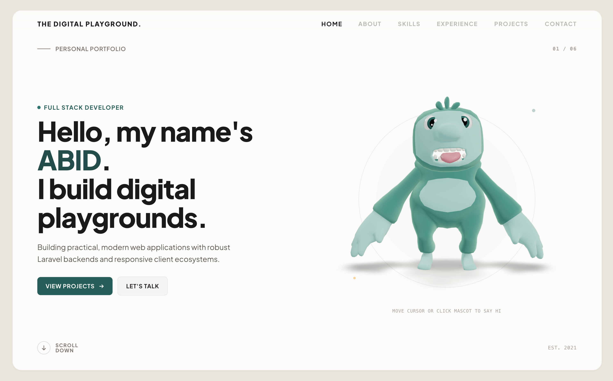

# 🎮 The Digital Playground

> **A little world where code meets imagination.**

  

  <em>An interactive developer portfolio inspired by miniature worlds, animated characters, and playful storytelling.</em>

---

## ✨ About The Project

**The Digital Playground** is an interactive developer portfolio that transforms the traditional portfolio experience into a small animated world.

Rather than simply displaying personal information, technical skills, and project collections, this portfolio invites visitors to explore a playful environment inhabited by unique monster characters.

Every section tells a different part of the developer's story, combining interactive elements, character animations, miniature-inspired environments, and cinematic visual details.

The goal is simple: make exploring a developer portfolio feel like discovering a little world.

## 🌍 Explore The World

The experience is divided into six main sections:

| Section | Description |
|---|---|
| 🏠 Home | A welcoming introduction to the developer and the world of The Digital Playground. |
| 👋 About | Discover the person behind the code, including background and personal interests. |
| 🧩 Skills | Explore technical skills, tools, and areas of expertise. |
| 📁 Experience | Follow the professional journey and development experience. |
| 🚀 Projects | Explore selected software projects, live demonstrations, and source code. |
| 💌 Contact | A final gathering where all monster characters come together. |

## 👾 Interactive Characters

Monsters are the recurring characters throughout the portfolio.

Each character represents a different section and has its own personality, visual identity, and animation behavior.

They are not just decorative elements. Their movements and interactions help bring the environment to life and make the browsing experience more engaging.

## 🎨 Design Philosophy

### Cinematic Miniature Rooms on Warm Paper

The visual direction combines a warm paper-inspired background with individual miniature environments surrounding each character.

The design focuses on:

- **Warm Atmosphere** — Off-white surfaces and subtle natural color variations.
- **Miniature Environments** — Room-inspired details that give every section its own identity.
- **Natural Lighting** — Soft ambient lighting and environmental shadows.
- **Character Focus** — Monsters remain the main visual attraction.
- **Interactive Storytelling** — Animations and transitions that support the narrative.
- **Visual Consistency** — Different environments connected through one cohesive visual language.

The intention is to create a playful yet polished experience without overwhelming visitors with unnecessary visual elements.

## 🚀 Featured Projects

The Projects section showcases selected software development work across different areas, including:

- Web applications.
- Internal management systems.
- Desktop applications.
- Productivity tools.
- Educational platforms.

Each project can provide relevant information such as its overview, technology stack, preview image, live demo, and source code repository.

## 🛠️ Technology

The project uses the technologies and tools defined in its source code and dependency configuration.

The development approach emphasizes:

- Reusable components.
- Responsive layouts.
- Interactive animations.
- Maintainable architecture.
- Performance-conscious rendering.
- Clean and consistent UI implementation.

For the complete technology stack, please refer to the project's source code and dependency manifests.

## 📱 Responsive Experience

The Digital Playground is designed to be explored across desktop, tablet, and mobile devices.

The responsive experience aims to preserve:

- Clear content hierarchy.
- Comfortable navigation.
- Character visibility.
- Consistent visual identity.
- Smooth and accessible interactions.

## 🎯 Project Goals

This project explores how a developer portfolio can become a more memorable digital experience through:

1. Creative visual storytelling.
2. Character-driven interactions.
3. Immersive miniature environments.
4. Thoughtful animation and motion design.
5. A balance between creativity and usability.

## 💌 Get in Touch

Have an idea, collaboration opportunity, or project to discuss?

Feel free to explore the Contact section and send a message.

---

  <strong>The Digital Playground</strong>
   
  <em>Not just a portfolio. A little world waiting to be explored.</em>

